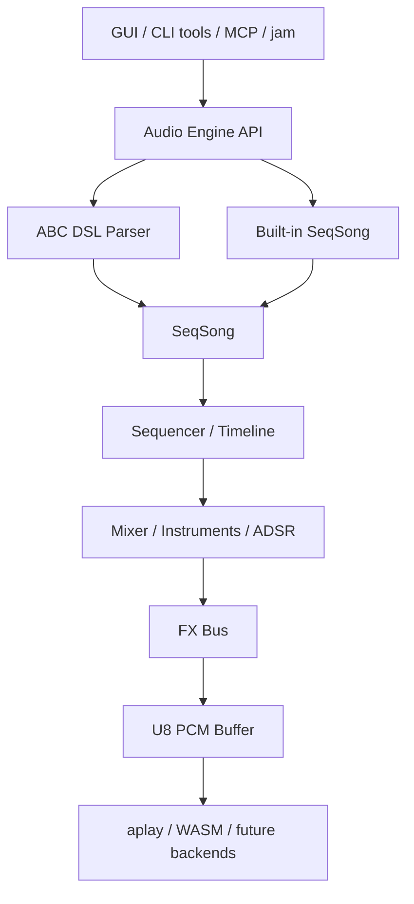

# Audio Architecture

Electric Pulse now renders built-in songs and ABC tracks through the same portable engine path.

The engine is Sonomorph's `chip8` module, pinned as the `vendor/sonomorph`
submodule ([ADR-0004](adr/adr-0004-sonomorph-engine.md)); its sources are in
`vendor/sonomorph/engine/chip8/`. Engine changes are made in Sonomorph, then pinned
here. The Rust GUI reaches it through `sonomorph::chip8` (see
[gui-ffi.md](gui-ffi.md)); the C tools (tests, demo renderer, MCP server, jam
player) compile its sources directly.

## Public API

Declared in `vendor/sonomorph/engine/chip8/electric_pulse.h` and `audio_engine.h`:

- `audio_engine_render_builtin_menu()`
- `audio_engine_render_abc_file()`
- `audio_engine_render_song()`
- `audio_engine_free_buffer()`

All render functions return a heap-allocated U8 PCM buffer on success and `NULL` on failure. The caller owns the returned buffer and must release it with `audio_engine_free_buffer()`.

## Data flow

## Modules

In `vendor/sonomorph/engine/chip8/`:

- `audio_engine.c`: stable render entry points, ownership rules, render statistics
- `abc.c`: ABC parsing, DSL validation, legacy ABC compatibility, `AbcMusic -> SeqSong`
- `audio_song_builtin.c`: built-in menu `SeqSong`
- `audio_seq.c`: deterministic timeline compilation and step event collection
- `audio_mix.c`: voice allocation, oscillators, instruments, note events, track mixing
- `audio_fx.c`: delay, drive, low-pass, sidechain, clipping statistics helper

## Diagnostics

`AudioRenderStats` reports:

- sample count
- duration in ms
- min/max sample
- peak offset from center (`128`)
- clipping count
- checksum
- render time in ms

The engine computes these after rendering so tests, demo rendering, and debug output share the same metrics.

## Ownership and failure rules

- render failures leave `out_len` at `0`
- render failures return `NULL`
- partially rendered buffers are freed internally on failure paths
- callers may pass `NULL` for optional stats
- `audio_engine_free_buffer(NULL)` is safe
